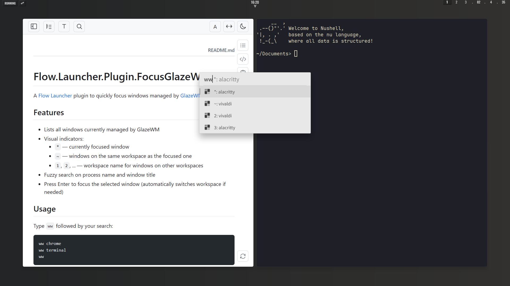

# Flow.Launcher.Plugin.FocusGlazeWM

A [Flow Launcher](https://github.com/Flow-Launcher/Flow.Launcher) plugin to quickly focus windows managed by [GlazeWM](https://github.com/glzr-io/glazewm).



## Features

- Lists all windows currently managed by GlazeWM
- Visual indicators:
  - `*` — currently focused window
  - `~` — windows on the same workspace as the focused one
  - `1`, `2`, ... — workspace name for windows on other workspaces
- Fuzzy search on process name and window title
- Press Enter to focus the selected window (automatically switches workspace if needed)

## Usage

Type `ww` followed by your search:

```
ww chrome
ww terminal
ww
```

Empty query shows all windows (focused window first).

## Requirements

- [GlazeWM](https://github.com/glzr-io/glazewm) must be running
- `glazewm` CLI must be available in your PATH

## Installation

```text
pm install https://github.com/yuruyurau/Flow.Launcher.Plugin.FocusGlazeWM/releases/latest/download/FocusGlazeWM.zip
```

**Or**

1. Download the latest release from [Releases](https://github.com/yuruyurau/Flow.Launcher.Plugin.FocusGlazeWM/releases).
2. Extract the zip to `%APPDATA%/FlowLauncher/Plugins/FocusGlazeWM/`.
3. Restart Flow Launcher.

## Credits

- [Flow Launcher](https://github.com/Flow-Launcher/Flow.Launcher)
- [GlazeWM](https://github.com/glzr-io/glazewm)
- Assisted by [Grok](https://grok.com)
